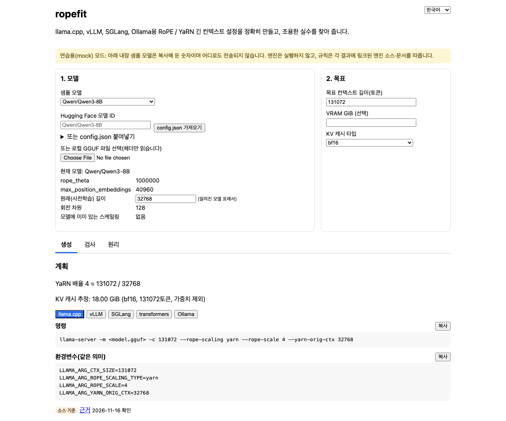
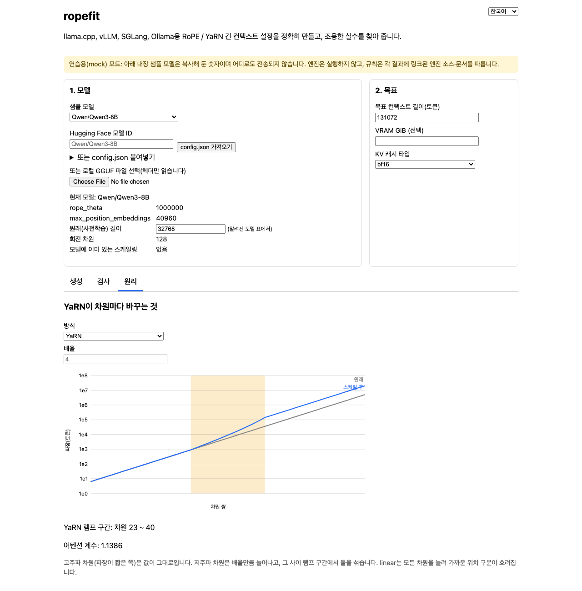
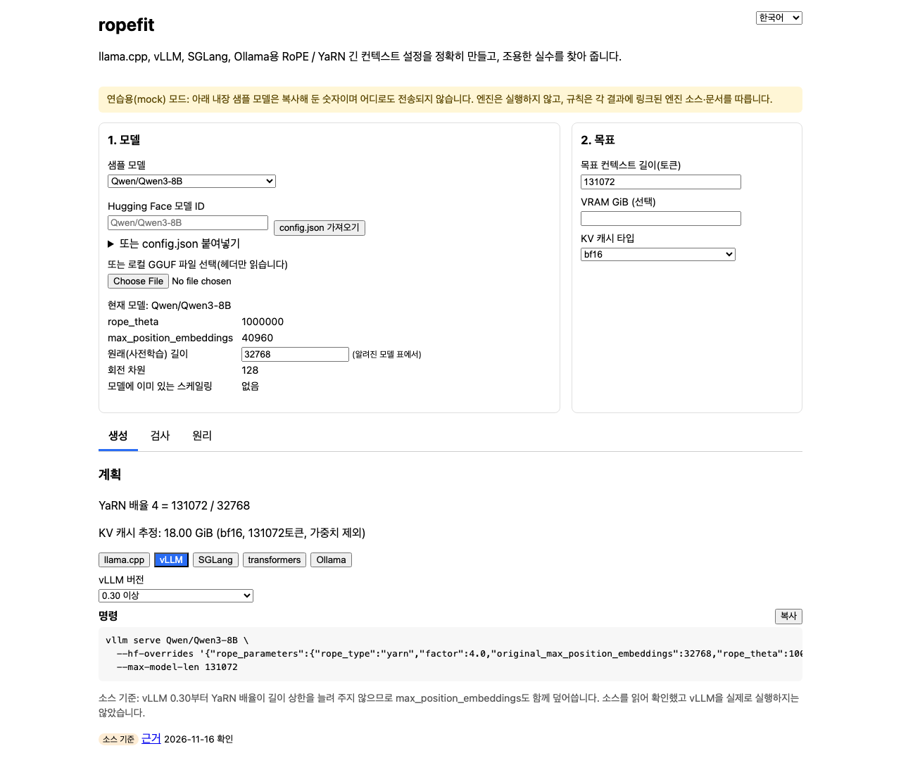
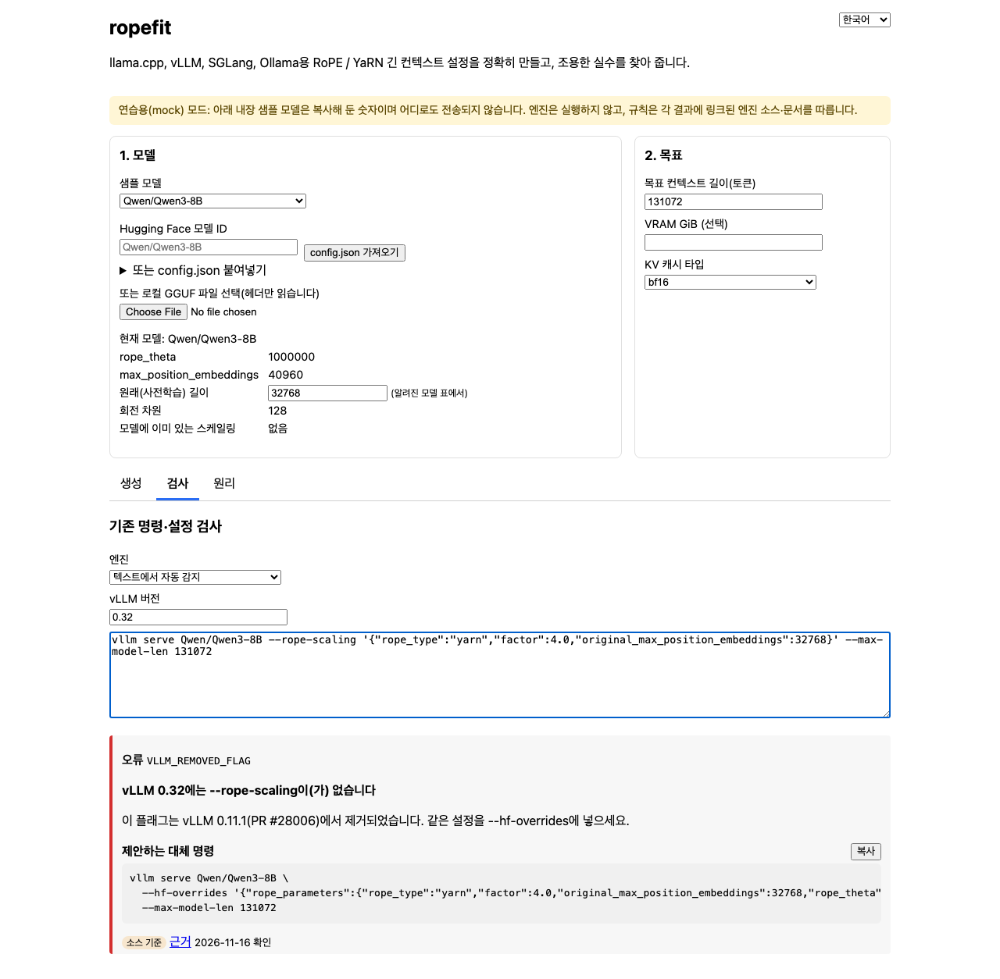
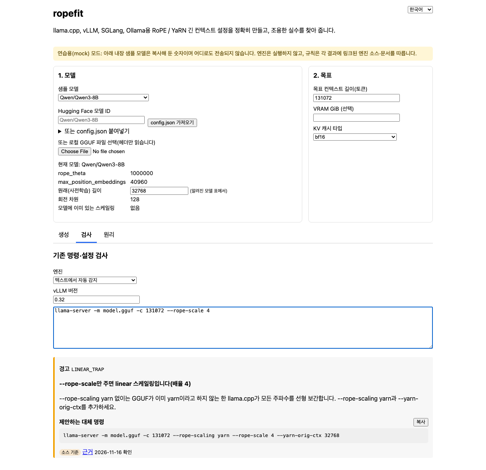
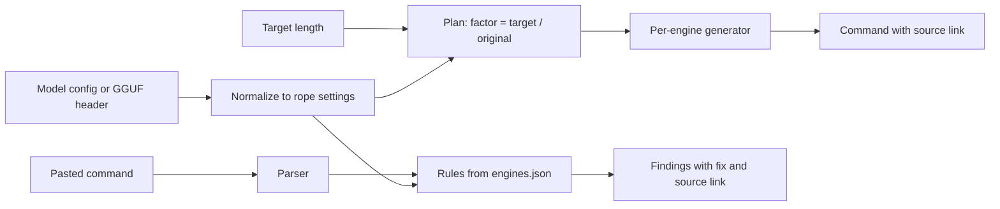

# ropefit

[English](README.md) | **한국어**

ropefit 은 모델 config 와 목표 컨텍스트 길이를 넣으면 llama.cpp·vLLM·SGLang·transformers·Ollama 에 맞는 정확한 RoPE/YaRN 설정을 만들어 주고, 이미 쓰던 명령의 조용한 실수를 짚어 주는 설치 없는 브라우저 앱입니다. 모델을 직접 서빙하면서 학습 길이보다 긴 입력을 넣으려는 사람을 위한 도구입니다. `npm install && npm start` 로 실행합니다.

모델의 컨텍스트를 32K 에서 128K 로 늘릴 때, 모델 카드에서 복사한 플래그가 거부되거나, 무시되거나, 받아들여지긴 했는데 긴 입력에서 조용히 답이 나빠지는 일이 있습니다. ropefit 은 엔진·버전에 맞는 명령을 만들고, 각 규칙에 근거 링크와 확인 날짜를 붙여 보여 줍니다.


*내장 Qwen3-8B 샘플에 목표 131072 토큰을 넣은 생성(Generate) 탭: 배율 4 = 131072 / 32768 과 llama.cpp 명령.*

## 이런 분께

- Qwen3·Llama·DeepSeek 모델을 내 컴퓨터나 서버에 띄우고 32K 대신 128K 를 쓰려는 분.
- 모델 카드의 `vllm serve ... --rope-scaling ...` 을 복사했더니 엔진이 거부하거나, 받아들이는데 긴 답이 나빠지는 분.
- llama.cpp 에 `--rope-scale 4` 만 줬는데 YaRN 인지 선형 보간인지 확신이 없는 분.
- Ollama 에서 YaRN 을 켜는 방법을 찾는 분.

## 설치

Node.js 와 npm 이 필요합니다(프로젝트는 Node `^22.22.2 || ^24.15.0 || >=26.0.0` 을 요구하며, 확인한 환경은 Node 26.13.0, npm 11.20.0 입니다).

```bash
# macOS: brew install node     Debian/Ubuntu: https://nodejs.org/ 에서 Node.js 를 설치하고 git 도 설치(또는 패키지 관리자 사용)
git clone https://github.com/LeeGyeongPil/ropefit.git
cd ropefit
npm install
```

앱은 정적 페이지입니다. `npm run build` 로 `dist/` 에 만들어지고, 어떤 정적 호스트에서나 서빙할 수 있습니다(에셋 경로는 상대 경로).

## 빠르게 시작하기

```bash
npm start
```

Vite 가 알려 주는 주소(기본 `http://localhost:5173`)를 엽니다. 내장 Qwen3-8B 샘플로 시작하므로 첫 화면부터 결과가 보입니다.

1. **모델**(왼쪽): 샘플의 `rope_theta`, `max_position_embeddings`, 원래(사전학습) 길이와 각 숫자의 출처가 보입니다.
2. **목표**(오른쪽): 목표 컨텍스트 길이, 기본값 131072.
3. **생성** 탭: 엔진을 고릅니다. 계획 줄에 `YaRN 배율 4 = 131072 / 32768` 이 나오고, 아래에 복사 버튼·근거 링크·확인 날짜와 함께 명령이 나옵니다.

Qwen3-8B, 목표 131072 에서 llama.cpp 출력은 다음과 같습니다.

```text
llama-server -m <model.gguf> -c 131072 --rope-scaling yarn --rope-scale 4 --yarn-orig-ctx 32768

LLAMA_ARG_CTX_SIZE=131072
LLAMA_ARG_ROPE_SCALING_TYPE=yarn
LLAMA_ARG_ROPE_SCALE=4
LLAMA_ARG_YARN_ORIG_CTX=32768
```

## 긴 컨텍스트가 조용히 나빠지는 이유

RoPE(회전 위치 임베딩)는 숫자 쌍을 서로 다른 속도로 돌려 각 토큰의 위치를 알려 줍니다. 시계 바늘처럼요. 빠른 바늘은 이웃한 토큰을, 느린 바늘은 멀리 떨어진 토큰을 구별합니다. 32K 위치까지만 학습한 모델은 느린 바늘이 그만큼 멀리 도는 것을 본 적이 없습니다.

32cm 자로 1m 를 재는 상황과 비슷합니다. 자의 눈금을 다시 매길 수는 있지만, 어떻게 매기느냐가 중요합니다.

- **선형(linear)** 은 모든 눈금을 같은 배율로 늘립니다. 이웃을 구별하던 눈금이 흐려집니다.
- **YaRN** 은 빠른 바늘은 그대로 두고, 느린 바늘만 배율만큼 늘리고, 그 사이 차원은 섞어 줍니다(램프 구간). 어텐션도 조금 키웁니다(`0.1 * ln(factor) + 1`, 배율 4 면 1.1386).
- **배율(factor)** 은 목표 길이 ÷ 모델의 원래 길이입니다: 131072 / 32768 = 4. 원래 길이는 `config.json` 의 `max_position_embeddings` 와 다를 때가 많습니다. Qwen3-8B 의 config 는 40960 이지만 모델 카드는 사전학습 길이를 32768 이라고 하므로, ropefit 은 32768 을 쓰고 그 출처를 화면에 보여 줍니다.

**원리(Explain)** 탭이 선택한 모델로 이것을 그려 줍니다.


*원리 탭: 회전 차원 쌍마다의 파장. YaRN 은 고주파 쪽은 그대로 두고 저주파 쪽을 늘리며, 23~40번 차원을 섞습니다.*

## 사용법

### 생성: 한 가지 의도, 엔진별 명령 하나

버튼으로 엔진을 고릅니다. vLLM 은 버전에 따라 문법이 바뀌었으므로 버전 구간도 고릅니다.


*vLLM 선택: 0.30 이상이면 설정이 `--hf-overrides` 로 들어가고 `max_position_embeddings` 도 함께 덮어씁니다.*

Qwen3-8B, 목표 131072, 배율 4 기준 엔진별 요약:

| 엔진 / 버전 | ropefit 이 출력하는 것 |
|---|---|
| llama.cpp | `llama-server -m <model.gguf> -c 131072 --rope-scaling yarn --rope-scale 4 --yarn-orig-ctx 32768` (같은 뜻의 `LLAMA_ARG_*` 환경변수도) |
| vLLM 0.11.0 이하 | `--rope-scaling '{...}' --rope-theta 1000000 --max-model-len 131072` |
| vLLM 0.11.1 | `--hf-overrides '{"rope_scaling":{...}}' --max-model-len 131072` |
| vLLM 0.12 ~ 0.29 | `--hf-overrides '{"rope_parameters":{..., "rope_theta":1000000}}' --max-model-len 131072` |
| vLLM 0.30 이상 | 0.12 ~ 0.29 와 같고 override 안에 `"max_position_embeddings":131072` 추가 |
| SGLang | `--json-model-override-args '{"rope_scaling":{...,"rope_theta":1000000}}' --context-length 131072` |
| transformers | `config.rope_parameters = {...}` 와 `config.max_position_embeddings = 131072` |
| Ollama | 런타임 옵션이 없음. ropefit 이 이유를 설명하고 대신 llama.cpp 명령을 제안 |

vLLM 0.30 이상 출력 전체:

```text
vllm serve Qwen/Qwen3-8B \
  --hf-overrides '{"rope_parameters":{"rope_type":"yarn","factor":4.0,"original_max_position_embeddings":32768,"rope_theta":1000000},"max_position_embeddings":131072}' \
  --max-model-len 131072
```

선택 사항: VRAM(GiB)과 KV 캐시 타입을 넣으면 KV 캐시를 추정합니다(Qwen3-8B bf16: 32768 토큰 4.50 GiB, 131072 토큰 18.00 GiB). 캐시만으로 VRAM 을 넘으면 경고합니다. 가중치는 포함하지 않으며, 멀티헤드 잠재 어텐션이나 슬라이딩 윈도우 층이 있는 모델은 추정하지 않습니다.

### 검사: 기존 명령의 조용한 실수 찾기

**검사(Check)** 탭에 `llama-server` 명령, `vllm serve` 명령, SGLang 실행 명령, Ollama Modelfile, `config.json` 조각 중 하나를 붙여 넣습니다. 아무것도 실행하지 않고, 글을 해석해 아래 규칙과 비교합니다.

예: 모델 카드의 vLLM 명령을 vLLM 0.32 로 검사.


*제거된 플래그는 오류로 나오고, 대체 명령과 근거 링크가 함께 나옵니다.*

화면에 나오는 항목(오류, 근거: https://github.com/vllm-project/vllm/pull/28006):

```text
vLLM 0.32에는 --rope-scaling이(가) 없습니다
이 플래그는 vLLM 0.11.1(PR #28006)에서 제거되었습니다. 같은 설정을 --hf-overrides에 넣으세요.
```

제안되는 명령(화면에서 복사할 수 있음):

```text
vllm serve Qwen/Qwen3-8B \
  --hf-overrides '{"rope_parameters":{"rope_type":"yarn","factor":4.0,"original_max_position_embeddings":32768,"rope_theta":1000000},"max_position_embeddings":131072}' \
  --max-model-len 131072
```

예: llama.cpp 에 `--rope-scale 4` 만 준 경우.


*`--rope-scaling yarn` 이 없으면, GGUF 가 이미 YaRN 이라고 하지 않는 한 llama.cpp 는 선형으로 보간합니다.*

화면에 나오는 항목(경고):

```text
--rope-scale만 주면 linear 스케일링입니다(배율 4)
--rope-scaling yarn 없이는 GGUF가 이미 yarn이라고 하지 않는 한 llama.cpp가 모든 주파수를 선형 보간합니다. --rope-scaling yarn과 --yarn-orig-ctx를 추가하세요.
```

붙여 넣은 `llama-server -m qwen3-8b-q4_k_m.gguf -c 131072 --rope-scale 4` 에 대해, 제안 명령은 내 모델 경로를 그대로 유지합니다.

```text
llama-server -m qwen3-8b-q4_k_m.gguf -c 131072 --rope-scaling yarn --rope-scale 4 --yarn-orig-ctx 32768
```

규칙 12개:

| 규칙 | 심각도 | 잡아내는 것 | 근거 |
|---|---|---|---|
| `VLLM_REMOVED_FLAG` | 오류 | vLLM 0.11.1 에서 제거된 플래그 | 소스 |
| `THETA_MISSING` | 오류 | `rope_theta` 가 빠진 override (base 가 10000 으로 돌아갈 수 있음) | 소스 |
| `LINEAR_TRAP` | 경고 | `--rope-scaling yarn` 없는 `--rope-scale` | 소스 |
| `ORIG_CTX_MISMATCH` | 경고 | 모델과 다른 원래 길이 | 소스 |
| `FACTOR_TOO_SMALL` | 오류 | 배율 × 원래 길이가 요청한 컨텍스트보다 작음 | 문서 |
| `OVERRIDES_NATIVE` | 오류 | llama3·longrope·층별 방식을 덮어씀 | 문서 |
| `REPLACES_AUTHOR_VALUES` | 경고 | 제작자의 YaRN 값을 대체하는 override | 소스 |
| `STATIC_YARN_OVERSIZED` | 경고 | 필요보다 큰 배율(YaRN 은 정적이라 짧은 입력도 영향받음) | 문서 |
| `VLLM_V030_MAXLEN` | 오류 | vLLM 0.30 이상이 `max_position_embeddings` 를 넘는 길이를 거부 | 소스 |
| `OLLAMA_NO_RUNTIME_ROPE` | 경고 | Ollama 가 무시하는 Modelfile `rope_frequency_*` 매개변수 | 소스 |
| `KV_EXCEEDS_VRAM` | 경고 | KV 캐시만으로 VRAM 초과 | 문서 |
| `NO_SCALING_LONG_CTX` | 경고 | 스케일링 없이 원래 길이를 넘는 컨텍스트 요청(원래 길이가 추정값이면 정보) | 문서 |

"이중 스케일링"은 곱셈이 아닙니다. override 는 모델의 rope 설정을 **대체**하므로, 진짜 위험은 두 배율이 겹치는 것이 아니라 제작자의 값(예: `mscale`, `beta_fast`)을 잃는 것입니다. `REPLACES_AUTHOR_VALUES` 가 이를 경고하고, 생성기는 제작자의 추가 키를 보존합니다.

모든 결과에는 근거 링크와 확인 날짜가 붙습니다(이번 릴리스의 규칙은 2026-11-16, `NO_SCALING_LONG_CTX` 는 2026-11-26 확인). "소스"는 엔진 소스 코드에서, "문서"는 문서에서 읽은 규칙입니다.

### 모델 입력

| 입력 | 방법 |
|---|---|
| 내장 샘플 | Qwen3-8B, Llama-3.2-1B-Instruct, DeepSeek-V3, 예시용 층별 슬라이딩 윈도우 모델. 네트워크 없음 |
| Hugging Face 모델 ID | `owner/name`. 제출할 때만 `config.json` 하나를 한 번 가져옴 |
| `config.json` 붙여넣기 | 가져오기가 실패했을 때(게이트·비공개·오프라인) 자동으로 열리는 대안 |
| 로컬 GGUF 파일 | 브라우저에서 헤더만 읽음. 파일은 업로드되지 않음 |

## 설정

환경변수나 설정 파일은 없습니다.

- **언어**: 헤더의 언어 메뉴(English / 한국어)로 바꿉니다. 선택은 `localStorage` 의 `ropefit.lang` 에 저장됩니다. 첫 방문에는 브라우저 언어가 정합니다(`ko` 로 시작하면 한국어, 아니면 영어). 주소의 `?lang=ko` 또는 `?lang=en` 이 둘보다 우선합니다.
- **연습용(mock) 모드**: 내장 샘플은 공개 config 에서 옮긴 숫자이며, 화면에도 그렇게 표시됩니다. 계산과 규칙은 실제 입력과 같은 코드입니다. 엔진을 띄우지 않으므로 실제 서버가 어떻게 동작하는지는 알려 주지 못합니다.
- **규칙 데이터**: 엔진 버전 구간과 규칙은 `src/rules/engines.json` 에 있고, 각각 `sourceUrl`·`checked`·`basis` 를 가집니다. 엔진이 바뀌면 이 파일을 고칩니다.

## 동작 원리



- 모델 입력은 몇 개의 숫자로 정규화됩니다: `rope_theta`, 원래 길이, 회전 차원, 모델에 이미 있는 스케일링.
- 계획은 목표를 원래 길이로 나누거나, 스케일링이 필요 없다고 하거나, 모델 고유 방식을 유지하라고 알려 줍니다.
- 엔진마다 생성기가 있고, vLLM 은 버전 구간도 따로 있어서 같은 의도가 맞는 문법이 됩니다.
- 검사기는 붙여 넣은 글을 같은 정규화 형태로 해석해 규칙을 돌리고, 고친 명령은 생성기가 만듭니다.
- 모든 계산은 React 없이 순수 TypeScript 인 `src/core/` 에 있어 페이지 밖에서도 재사용할 수 있습니다.

## 언제 쓰나

- 잘 맞는 경우: llama.cpp·vLLM·SGLang·Ollama 로 직접 모델을 서빙하며, 설치 없이 올바른 긴 컨텍스트 설정을 얻거나 기존 명령을 다시 확인하고 싶을 때.
- 다루지 않는 것: 엔진을 실행하거나 답변 품질을 재지 않으며, Docker·compose·Kubernetes 파일 안의 명령은 읽지 않습니다(셸 명령 한 줄·Modelfile·config 조각만).
- 엔진 자체의 옵션은 공식 문서를 보세요: [llama.cpp server](https://github.com/ggml-org/llama.cpp/tree/master/tools/server), [vLLM context extension](https://docs.vllm.ai/en/latest/features/context_extension/), [transformers RoPE utilities](https://huggingface.co/docs/transformers/en/internal/rope_utils).

## 관련 도구

2026-11-16 확인.

- [entail](https://github.com/wwoosshh/Entail) (`pip install entail-ai`): 모델이 선언한 값과 transformers·vLLM·SGLang 이 로드 시점에 실제로 쓰는 값을 비교해 경고하거나 고치는 Python 런타임 훅입니다(RoPE theta 누락도 그중 하나). llama.cpp 와 Ollama 는 대상이 아니고 설정을 생성하지 않습니다. 로드 시점에는 entail, 띄우기 전에는 ropefit 을 쓰세요.
- [llama.cpp 저장소](https://github.com/ggml-org/llama.cpp/tree/master/gguf-py)의 gguf-py 도구: `gguf-dump` 는 GGUF 파일의 `rope.*` 키를 보여 주고, `gguf-set-metadata` 는 이미 있는 키의 값을 바꿉니다(시험해 보니 없는 키는 추가하지 못했습니다). 엔진 설정을 생성하거나 검사하지는 않습니다.

## 한계

- 규칙을 엔진을 실행해 검증하지는 않았습니다. 엔진 소스와 문서를 따릅니다. vLLM 0.30 이상 길이 상한(`VLLM_V030_MAXLEN`)은 소스를 읽기만 했고, 화면에도 "소스 기준"으로 표시됩니다.
- Ollama 는 안내만 합니다. 검사 탭은 Modelfile 의 `PARAMETER rope_frequency_*` 줄만 읽습니다.
- 멀티헤드 잠재 어텐션·슬라이딩 윈도우 모델은 KV 추정을 하지 않습니다.
- 원격 GGUF URL, 공유 링크, CLI 는 이번 릴리스에 없습니다.
- llama.cpp 의 `--rope-scale 1` 은 "스케일링 설정됨"으로 취급되어 `NO_SCALING_LONG_CTX` 가 나오지 않습니다.

## 자주 겪는 문제

| 증상 | 원인 | 해결 |
|---|---|---|
| 모델 ID 를 넣었더니 "설정을 자동으로 불러오지 못했습니다" | 게이트·비공개 모델이거나, ID 가 틀렸거나, 오프라인 | 열린 입력칸에 `config.json` 을 붙여 넣기 |
| 검사가 엔진을 인식하지 못함 | `llama-server`·`vllm serve`·SGLang 명령, Modelfile, JSON 조각이 아님 | 명령 자체를 붙여 넣거나 드롭다운에서 엔진 고르기 |
| 원래 길이가 이상함 | config 에 명시된 값이 없어 `max_position_embeddings` 로 가정함 | 모델 카드를 읽고 "원래(사전학습) 길이" 값을 직접 고치기 |
| "스케일링이 필요 없음"이라고 나옴 | 목표가 원래 길이 이내 | 목표를 그 위로 올리기 |
| 규칙의 확인 날짜가 오래됨 | 엔진이 바뀜 | `src/rules/engines.json` 을 고치고 테스트 다시 실행 |

## 개발·기여

```bash
npm test
npm run typecheck
npm run build
```

이번 릴리스에서 확인한 결과: 12개 파일의 테스트 80개 통과, 타입 검사 통과, 빌드가 `dist/` 를 만듭니다. 버그·제안은 이슈로 남겨 주세요. 변경 기록은 [CHANGELOG.md](CHANGELOG.md).

## 언어

화면은 영어와 한국어를 지원하고, README 도 두 언어로 있습니다: [README.md](README.md).

## 라이선스

MIT. 내장 샘플은 공개 모델 config 의 숫자를 옮긴 것이며, 각 모델은 자체 라이선스를 따릅니다.
