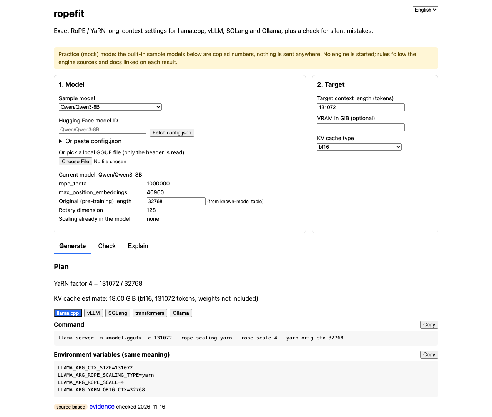
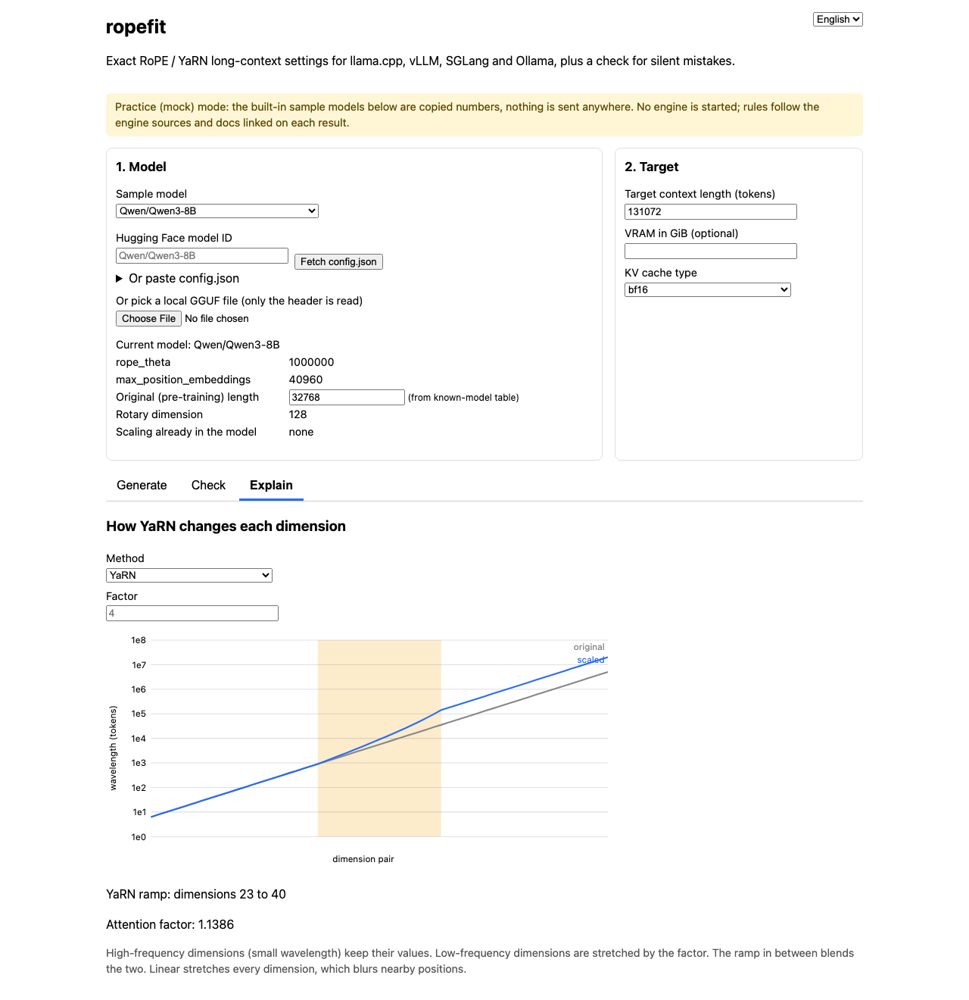
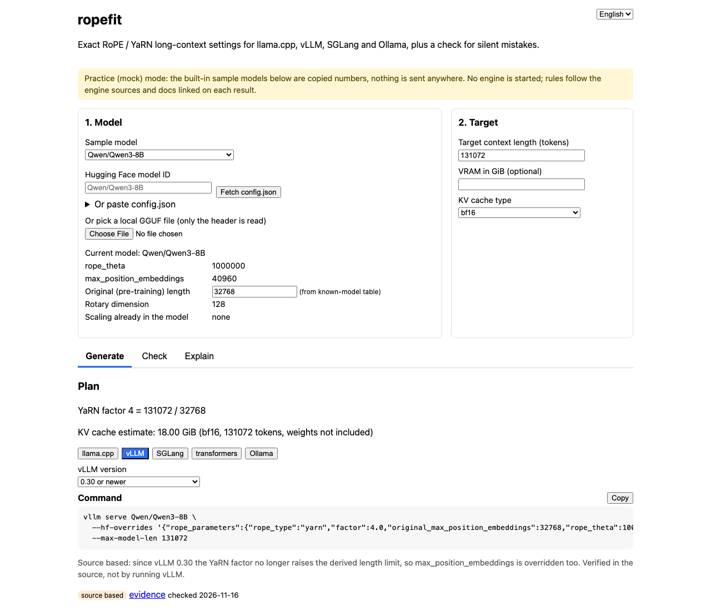
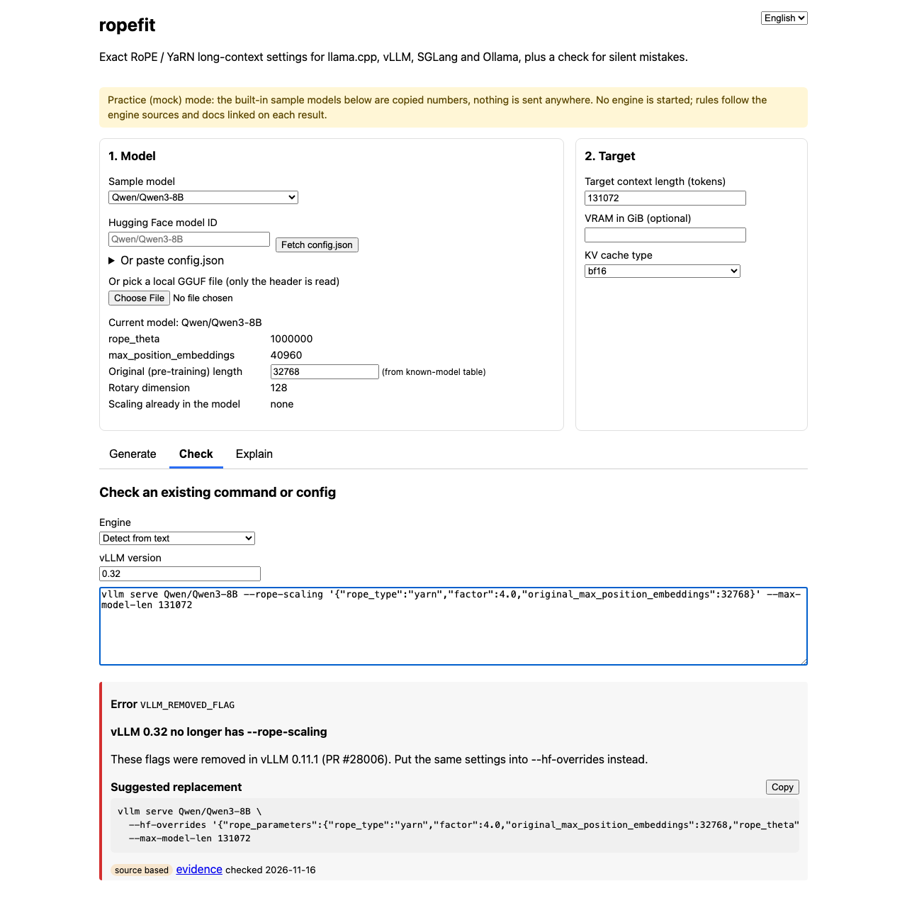
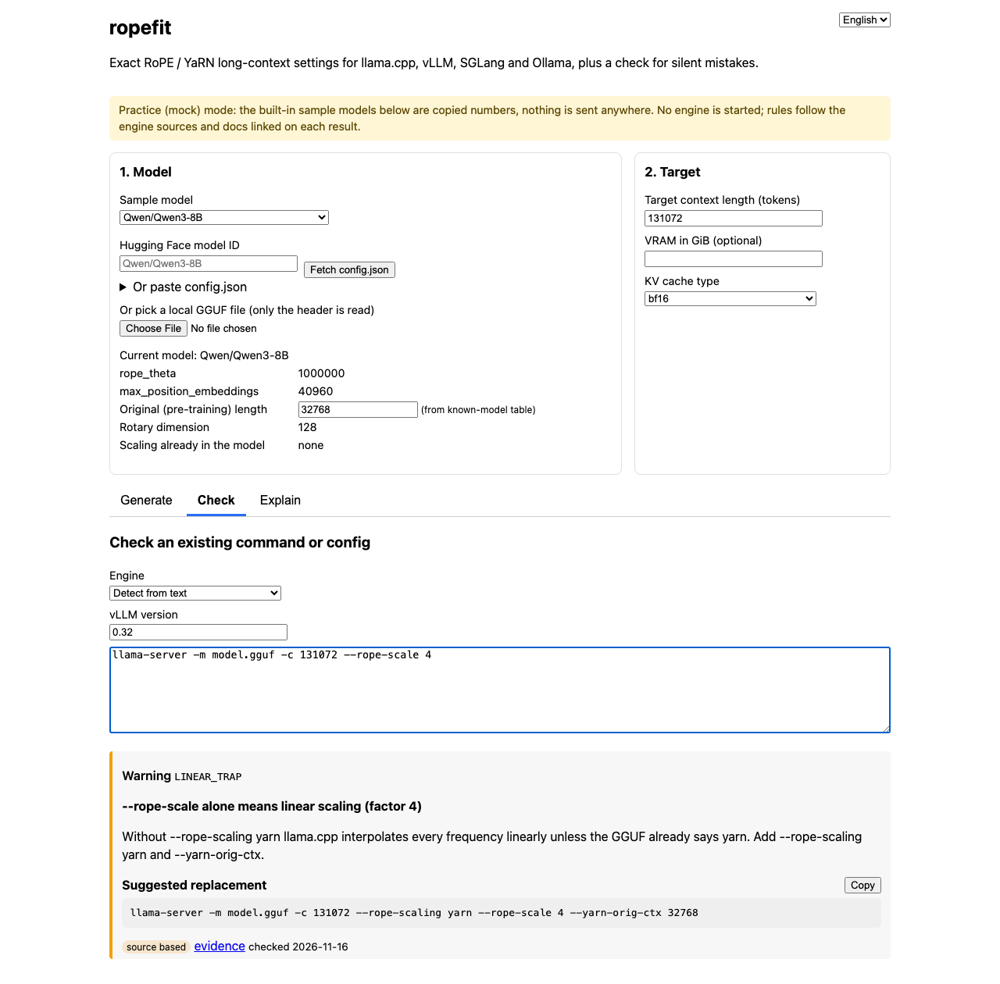
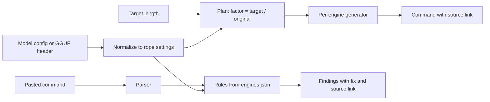

# ropefit

**English** | [한국어](README.ko.md)

ropefit is a no-install browser app that turns a model's config and a target context length into the exact RoPE/YaRN settings for llama.cpp, vLLM, SGLang, transformers and Ollama, and flags silent mistakes in commands you already have. It is for people who serve a model themselves and want to feed it inputs longer than it was trained on. Run it with `npm install && npm start`.

When you stretch a model's context from 32K to 128K, the flag you copied from a model card may be rejected, ignored, or accepted while quietly making answers worse on long inputs. ropefit gives you the command for your engine and version, and explains each rule with a source link and the date it was checked.


*The Generate tab for the built-in Qwen3-8B sample with a 131072-token target: factor 4 = 131072 / 32768, and the llama.cpp command.*

## Who it is for

- You run Qwen3, Llama or DeepSeek models on your own machine or server and want 128K instead of 32K.
- You copied `vllm serve ... --rope-scaling ...` from a model card and the engine rejects it, or accepts it and long answers get worse.
- You passed `--rope-scale 4` to llama.cpp and want to be sure it is YaRN and not linear interpolation.
- You are looking for the way to turn on YaRN in Ollama.

## Install

You need Node.js with npm (the project declares Node `^22.22.2 || ^24.15.0 || >=26.0.0`; the verified run used Node 26.13.0 and npm 11.20.0).

```bash
# macOS: brew install node     Debian/Ubuntu: install Node.js from https://nodejs.org/ (or your package manager) and git
git clone https://github.com/LeeGyeongPil/ropefit.git
cd ropefit
npm install
```

The app is a static page. `npm run build` writes it to `dist/`, which any static host can serve (asset paths are relative).

## Quick start

```bash
npm start
```

Open the address Vite prints (by default `http://localhost:5173`). The first screen already shows a result, because it starts with the built-in Qwen3-8B sample.

1. **Model** (left): the sample's `rope_theta`, `max_position_embeddings` and original (pre-training) length are shown with where each number came from.
2. **Target** (right): the target context length, default 131072.
3. **Generate** tab: pick an engine. The plan line says `YaRN factor 4 = 131072 / 32768`, and the command appears below with a Copy button, the evidence link and the date it was checked.

For Qwen3-8B and a 131072 target, the llama.cpp output is:

```text
llama-server -m <model.gguf> -c 131072 --rope-scaling yarn --rope-scale 4 --yarn-orig-ctx 32768

LLAMA_ARG_CTX_SIZE=131072
LLAMA_ARG_ROPE_SCALING_TYPE=yarn
LLAMA_ARG_ROPE_SCALE=4
LLAMA_ARG_YARN_ORIG_CTX=32768
```

## Why long context silently degrades

RoPE (rotary position embedding) tells the model where each token is by rotating pairs of numbers at different speeds, like the hands of a clock. Fast hands separate neighbouring tokens; slow hands separate far-away ones. A model trained on 32K positions has never seen the slow hands turn that far.

Think of a 32 cm ruler used to measure 1 m. You can re-mark the ruler (scaling), but how you re-mark it matters:

- **Linear** stretches every mark by the same factor. Marks that used to tell neighbours apart get blurry.
- **YaRN** keeps the fast hands as they are, stretches the slow ones by the factor, and blends the dimensions in between (the "ramp"). It also scales attention slightly (`0.1 * ln(factor) + 1`, which is 1.1386 for factor 4).
- The **factor** is the target length divided by the model's original length: 131072 / 32768 = 4. The original length is often not the same as `max_position_embeddings` in `config.json`. For Qwen3-8B the config says 40960, but the model card says 32768 is the pre-training length, so ropefit uses 32768 and shows where the number came from.

The **Explain** tab draws this for the model you picked.


*Explain tab: wavelength of each rotary dimension pair. YaRN leaves the high-frequency side alone, stretches the low-frequency side, and blends dimensions 23 to 40.*

## Usage

### Generate: one intent, one command per engine

Choose the engine with the buttons. For vLLM, also choose the version band, because the syntax changed between versions.


*vLLM selected: for 0.30 or newer the settings go into `--hf-overrides`, and `max_position_embeddings` is overridden too.*

Engine cheat sheet for Qwen3-8B, target 131072, factor 4:

| Engine / version | What ropefit prints |
|---|---|
| llama.cpp | `llama-server -m <model.gguf> -c 131072 --rope-scaling yarn --rope-scale 4 --yarn-orig-ctx 32768` (plus the same as `LLAMA_ARG_*` variables) |
| vLLM 0.11.0 or older | `--rope-scaling '{...}' --rope-theta 1000000 --max-model-len 131072` |
| vLLM 0.11.1 | `--hf-overrides '{"rope_scaling":{...}}' --max-model-len 131072` |
| vLLM 0.12 to 0.29 | `--hf-overrides '{"rope_parameters":{..., "rope_theta":1000000}}' --max-model-len 131072` |
| vLLM 0.30 or newer | like 0.12 to 0.29, plus `"max_position_embeddings":131072` inside the override |
| SGLang | `--json-model-override-args '{"rope_scaling":{...,"rope_theta":1000000}}' --context-length 131072` |
| transformers | `config.rope_parameters = {...}` and `config.max_position_embeddings = 131072` |
| Ollama | no runtime option; ropefit explains this and offers the llama.cpp command instead |

The vLLM 0.30 or newer output in full:

```text
vllm serve Qwen/Qwen3-8B \
  --hf-overrides '{"rope_parameters":{"rope_type":"yarn","factor":4.0,"original_max_position_embeddings":32768,"rope_theta":1000000},"max_position_embeddings":131072}' \
  --max-model-len 131072
```

Optional: enter your VRAM in GiB and a KV cache type. The page estimates the KV cache (Qwen3-8B in bf16: 4.50 GiB at 32768 tokens, 18.00 GiB at 131072) and warns if the cache alone does not fit. Weights are not included, and the estimate is skipped for models with multi-head latent attention or sliding-window layers.

### Check: find silent mistakes in an existing command

Open the **Check** tab and paste a `llama-server` command, a `vllm serve` command, an SGLang launch command, an Ollama Modelfile, or a `config.json` fragment. Nothing is run; the text is parsed and compared against the rules below.

Example: the vLLM command from a model card, checked as vLLM 0.32.


*The removed flag is an error, with a replacement command and the evidence link.*

The finding on the page (error, evidence: https://github.com/vllm-project/vllm/pull/28006):

```text
vLLM 0.32 no longer has --rope-scaling
These flags were removed in vLLM 0.11.1 (PR #28006). Put the same settings into --hf-overrides instead.
```

The suggested command (copyable on the page):

```text
vllm serve Qwen/Qwen3-8B \
  --hf-overrides '{"rope_parameters":{"rope_type":"yarn","factor":4.0,"original_max_position_embeddings":32768,"rope_theta":1000000},"max_position_embeddings":131072}' \
  --max-model-len 131072
```

Example: llama.cpp with only `--rope-scale 4`.


*Without `--rope-scaling yarn`, llama.cpp interpolates linearly unless the GGUF already says YaRN.*

The finding on the page (warning):

```text
--rope-scale alone means linear scaling (factor 4)
Without --rope-scaling yarn llama.cpp interpolates every frequency linearly unless the GGUF already says yarn. Add --rope-scaling yarn and --yarn-orig-ctx.
```

For the pasted `llama-server -m qwen3-8b-q4_k_m.gguf -c 131072 --rope-scale 4`, the suggested command keeps your own model path:

```text
llama-server -m qwen3-8b-q4_k_m.gguf -c 131072 --rope-scaling yarn --rope-scale 4 --yarn-orig-ctx 32768
```

The 11 rules:

| Rule | Severity | Catches | Basis |
|---|---|---|---|
| `VLLM_REMOVED_FLAG` | error | vLLM flags removed in 0.11.1 | source |
| `THETA_MISSING` | error | an override that drops `rope_theta` (base can fall back to 10000) | source |
| `LINEAR_TRAP` | warning | `--rope-scale` without `--rope-scaling yarn` | source |
| `ORIG_CTX_MISMATCH` | warning | an original length that differs from the model's | source |
| `FACTOR_TOO_SMALL` | error | factor times original length below the requested context | docs |
| `OVERRIDES_NATIVE` | error | overriding llama3, longrope or per-layer schemes | docs |
| `REPLACES_AUTHOR_VALUES` | warning | an override that replaces the author's YaRN values | source |
| `STATIC_YARN_OVERSIZED` | warning | a factor larger than needed (YaRN is static, so short inputs are affected too) | docs |
| `VLLM_V030_MAXLEN` | error | vLLM 0.30+ rejecting a length above `max_position_embeddings` | source |
| `OLLAMA_NO_RUNTIME_ROPE` | warning | `rope_frequency_*` Modelfile parameters, ignored by Ollama | source |
| `KV_EXCEEDS_VRAM` | warning | KV cache alone larger than your VRAM | docs |

"Double scaling" is not a multiplication. An override replaces the model's rope settings, so the real risk is losing the author's values (for example `mscale` or `beta_fast`), not stacking two factors. `REPLACES_AUTHOR_VALUES` warns about that, and the generator keeps the author's extra keys.

Every finding shows a link to the evidence and the date it was checked (2026-11-16 for all rules in this release). "Source" means the rule was read from the engine's source code, "docs" means from its documentation.

### Model input

| Input | How |
|---|---|
| Built-in sample | Qwen3-8B, Llama-3.2-1B-Instruct, DeepSeek-V3 and an example layered sliding-window model; no network |
| Hugging Face model ID | `owner/name`; fetches only `config.json`, once, when you submit |
| Pasted `config.json` | the automatic fallback if the fetch fails (gated, private, offline) |
| Local GGUF file | only the header is read in the browser; the file is not uploaded |

## Configuration

There are no environment variables or config files.

- **Language**: use the language menu in the header (English or 한국어). The choice is stored in `localStorage` under `ropefit.lang`. On the first visit the browser language decides (Korean if it starts with `ko`, otherwise English). `?lang=ko` or `?lang=en` in the address overrides both.
- **Practice (mock) mode**: the built-in samples are copied numbers from public configs, and a note on the page says so. The calculation and the rules are the same code that runs on real input. No engine is started, so ropefit cannot tell you how a real server behaves.
- **Rules data**: engine version bands and rules live in `src/rules/engines.json`, each with `sourceUrl`, `checked` and `basis`. When an engine changes, edit this file.

## How it works



- The model input is normalized to a few numbers: `rope_theta`, the original length, the rotary dimension and any scaling already in the model.
- The plan divides the target by the original length, or says no scaling is needed, or says to keep the model's own scheme.
- Each engine has its own generator and, for vLLM, its own version band, so the same intent becomes the right syntax.
- The checker parses your text into the same normalized form and runs the rules against it; the fix is produced by the generator.
- All calculation is in `src/core/` as plain TypeScript with no React, so it can be reused outside the page.

## When to use it

- Good fit: you serve models yourself with llama.cpp, vLLM, SGLang or Ollama and want the right long-context settings, or a second look at an existing command, without installing anything.
- Not covered: it does not start an engine or measure answer quality, and it does not read commands inside Docker, compose or Kubernetes files (a single shell command, a Modelfile or a config fragment only).
- For the engines' own options, see the official docs: [llama.cpp server](https://github.com/ggml-org/llama.cpp/tree/master/tools/server), [vLLM context extension](https://docs.vllm.ai/en/latest/features/context_extension/), [transformers RoPE utilities](https://huggingface.co/docs/transformers/en/internal/rope_utils).

## Related tools

Checked 2026-11-16.

- [entail](https://github.com/wwoosshh/Entail) (`pip install entail-ai`): a Python runtime hook that compares the values a model declares with the values transformers, vLLM or SGLang actually use when the model loads, and warns or fixes (a missing RoPE theta is one case). It does not cover llama.cpp or Ollama and does not generate settings. Use it at load time and ropefit before you launch.
- gguf-py tools from the [llama.cpp repository](https://github.com/ggml-org/llama.cpp/tree/master/gguf-py): `gguf-dump` shows a GGUF file's `rope.*` keys, and `gguf-set-metadata` changes keys that already exist (in a probe it could not add a missing key). They do not generate or check engine settings.

## Limits

- No engine was run to verify the rules; they follow engine sources and docs. The vLLM 0.30+ length cap (`VLLM_V030_MAXLEN`) was read from the source only, and the page marks it "source based".
- Ollama is guidance only. The Check tab reads only `PARAMETER rope_frequency_*` lines of a Modelfile.
- No KV estimate for multi-head latent attention or sliding-window models.
- No warning is shown when a long context is requested without any scaling set.
- Remote GGUF URLs, share links and a CLI are not part of this release.

## Troubleshooting

| Symptom | Cause | Fix |
|---|---|---|
| "Could not load the config automatically" after entering a model ID | the model is gated or private, the ID is wrong, or you are offline | paste its `config.json` into the box that opens |
| Check says it could not recognize the engine | the text is not a `llama-server`, `vllm serve` or SGLang command, a Modelfile or a JSON fragment | paste the command itself, or pick the engine in the dropdown |
| The original length looks wrong | the config has no explicit value, so `max_position_embeddings` is assumed | read the model card and edit the "Original (pre-training) length" value |
| Result says "no scaling needed" | the target is within the original length | raise the target above it |
| A rule date looks old | engines change | edit `src/rules/engines.json` and re-run the tests |

## Development

```bash
npm test
npm run typecheck
npm run build
```

Verified in this release: 76 tests across 12 files pass, the type check passes, and the build writes `dist/`. Bugs and suggestions are welcome as issues. See [CHANGELOG.md](CHANGELOG.md) for changes.

## Language

The page is available in English and Korean; the README is available in both as well: [README.ko.md](README.ko.md).

## License

MIT. The built-in samples copy numbers from public model configs; each model keeps its own license.
